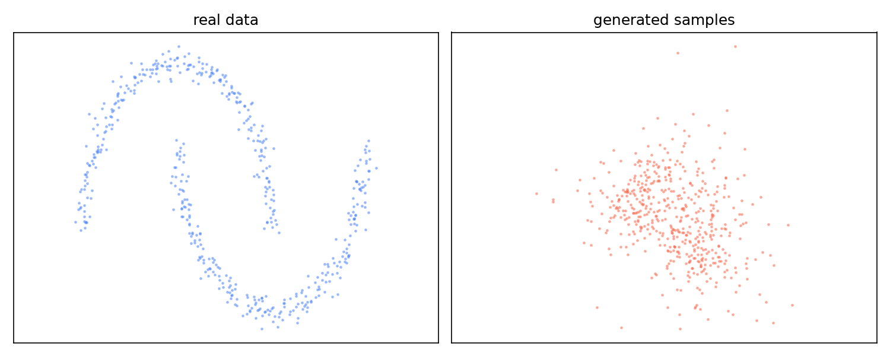

# TinyDiffusion

Train a residual denoiser on synthetic two-dimensional point clouds and plot samples beside the source distribution. Each residual block learns a scale for its timestep-dependent noise.

## Quick start

From the repository root, install the dependencies and run a small training and sampling check:

```sh
python -m pip install -r requirements.txt
python train.py --dataset moons --epochs 4 --n_samples 128 --batch_size 16 --hidden_dim 16 --depth 1 --time_dim 8 --timesteps 8
python sample.py --dataset moons --n_samples 64 --hidden_dim 16 --depth 1 --time_dim 8 --timesteps 8 --output samples.png
```

The short run checks the pipeline. For a longer experiment, use the defaults in both scripts.
Sampling validates the model dimensions and diffusion schedule saved in its checkpoint. Each
checkpoint records the dataset, architecture, schedule, and training seed; it does not contain
the source data or prove sample quality. Use checkpoints from a trusted source. Set `--seed` to
repeat a sampling run on the same software and hardware.

## Distribution check

After training, run `python evaluate.py --checkpoint model.pt --output_dir evaluation`.
The command saves `metrics.json` and `mmd.png`. It compares generated points with
independent synthetic samples using an unbiased RBF MMD² estimate, alongside a
Gaussian fitted to reference samples and an independent-reference comparison.
The kernel bandwidth comes from median pairwise reference distance and stays
fixed across repeats. Lower values indicate closer agreement for this kernel;
finite-sample unbiased estimates may be negative. The report records each
repeat, summary statistics, checkpoint configuration and SHA-256. Keep the
generated report and the exact checkpoint together when presenting results.
This check probes a two-dimensional synthetic distribution and is not evidence
of image generation quality or performance on real data.

## Sample run

This CPU run compares 512 reference points with 512 generated samples after 250 training updates. Use the quick-start commands with seed 42, 1,024 training points, batch size 64, hidden dimension 32, depth 2, time dimension 16 and 64 diffusion steps. The scatter plot shows sample geometry for one seed.



## Verification

Run the unit tests and the short end-to-end check:

```sh
python -m pytest -q
python train.py --dataset moons --epochs 4 --n_samples 128 --batch_size 16 --hidden_dim 16 --depth 1 --time_dim 8 --timesteps 8
python sample.py --dataset moons --n_samples 64 --hidden_dim 16 --depth 1 --time_dim 8 --timesteps 8 --output samples.png
python evaluate.py --checkpoint model.pt --n_samples 64 --repeats 2 --output_dir evaluation
```

The unit tests cover diffusion and denoiser invariants. The short run checks the
training, sampling, and evaluation commands; it does not establish sample quality.
Check that training writes `model.pt` and sampling produces
`samples.png` with two panels and evaluation writes a JSON report and plot.

## License

[MIT License](LICENSE) for the project code. Third-party software, models, and datasets retain their own terms.
